# Screenshot Gallery

Generated by `scripts/generate-gallery.sh` from the files in `evidence/screenshots/`.

### background-jobs.png

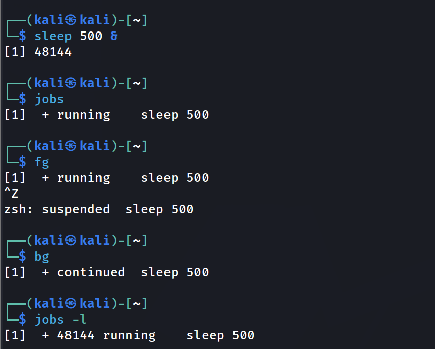

### copy-and-move.png

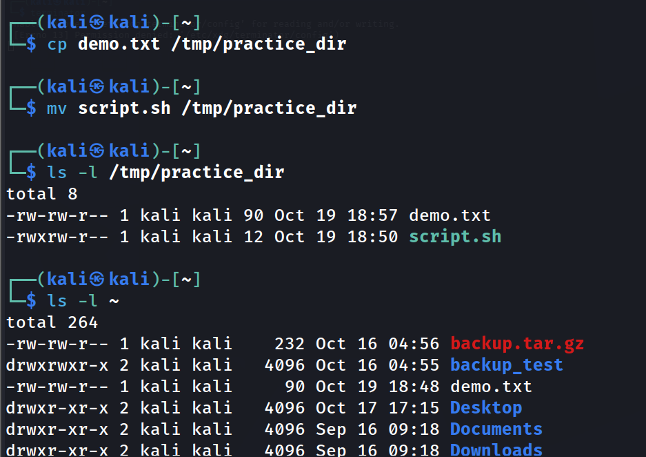

### demo-txt-created.png

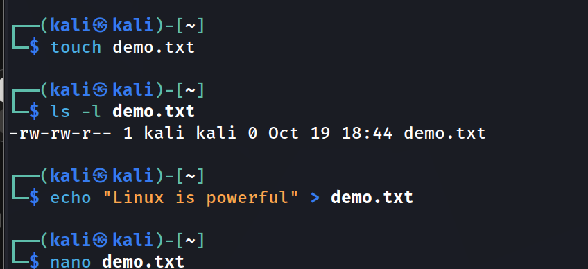

### df-and-free.png

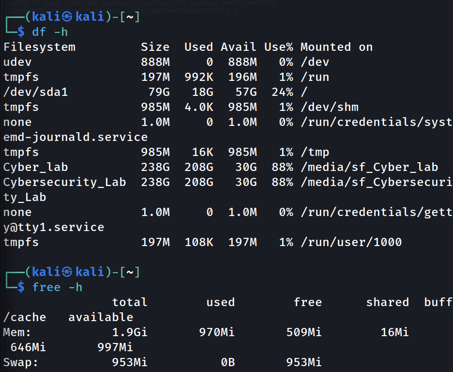

### editot-open.png

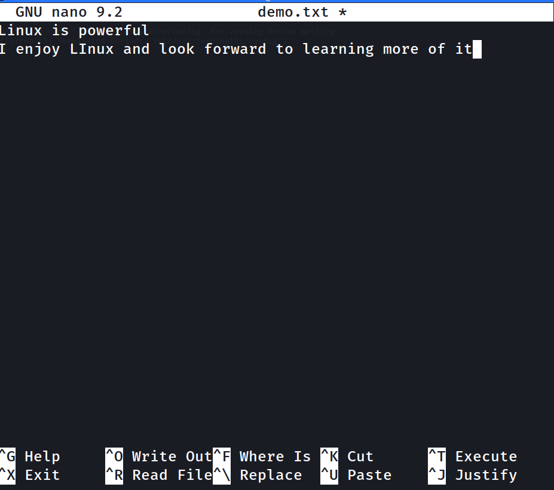

### environment-info.png

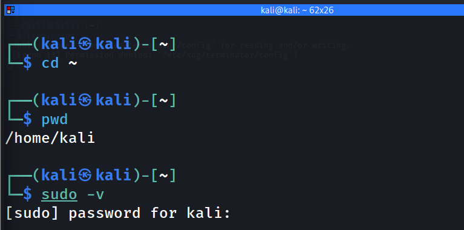

### extraction-verified.png

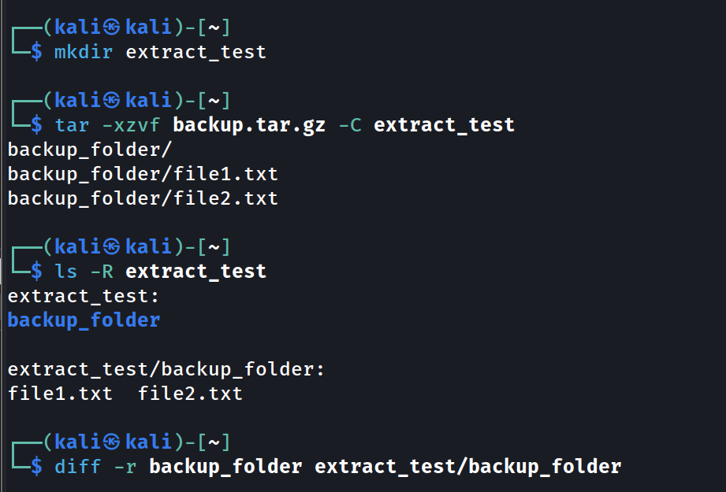

### google-ping.png

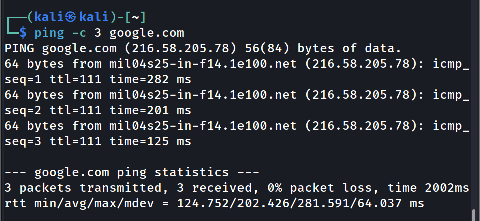

### kill-and-verify.png

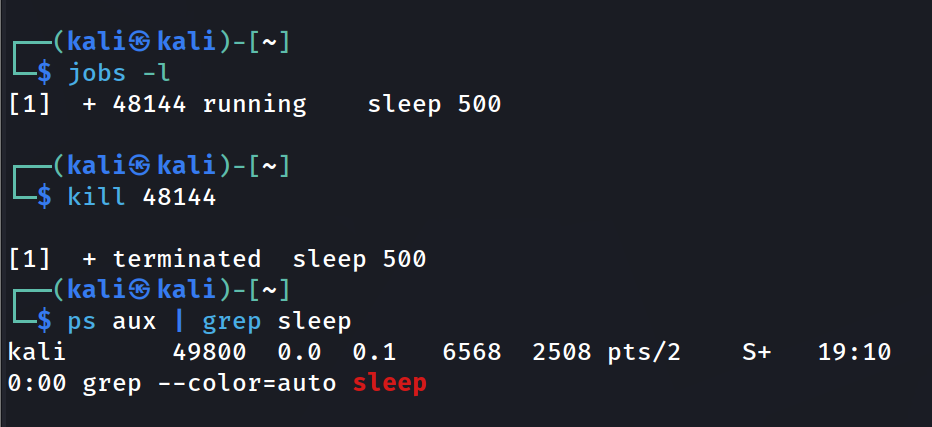

### permission-before-and-after.png

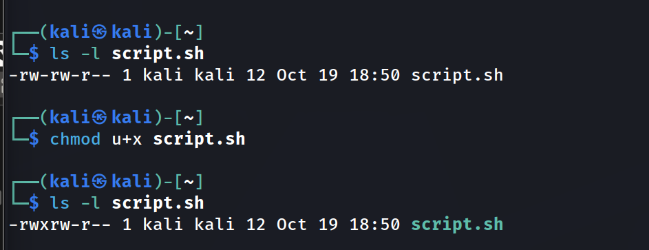

### practice-dir-created.png

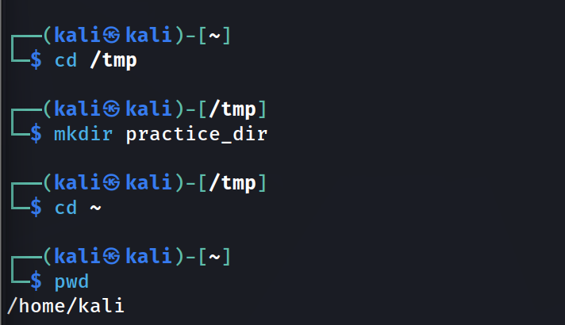

### rename-and-delete.png

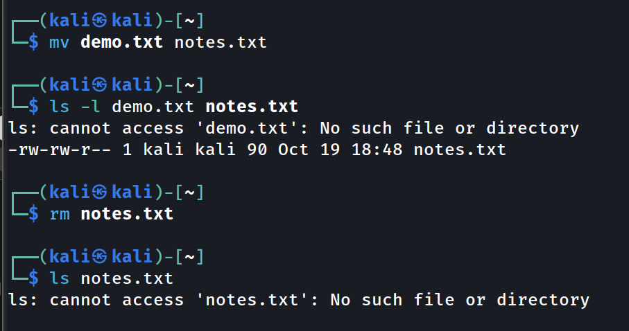

### script-sh-created.png

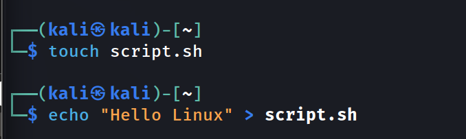

### student1-created-in-sudo.png

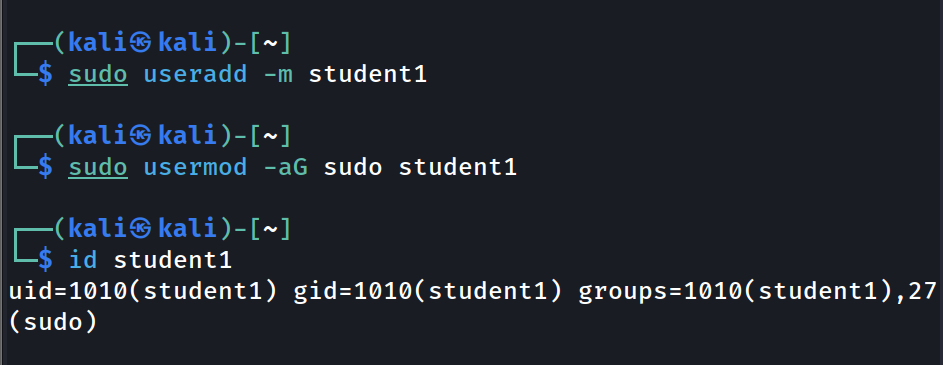

